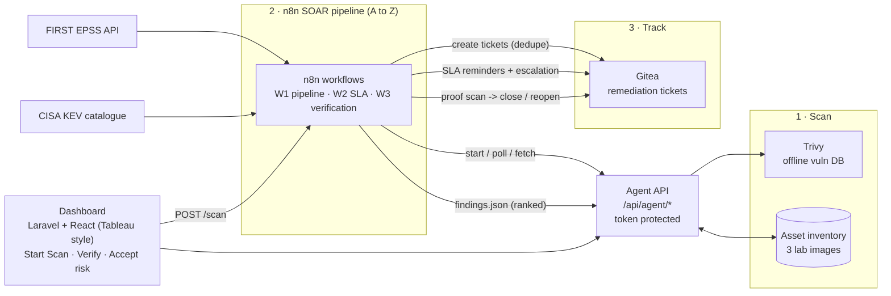
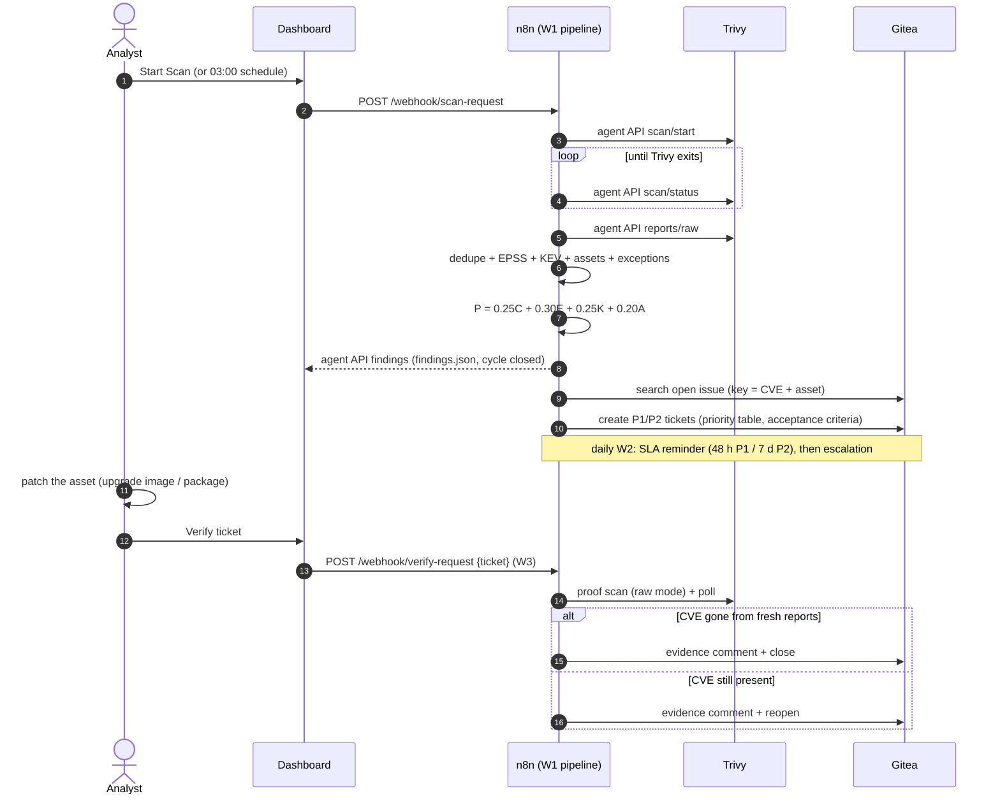
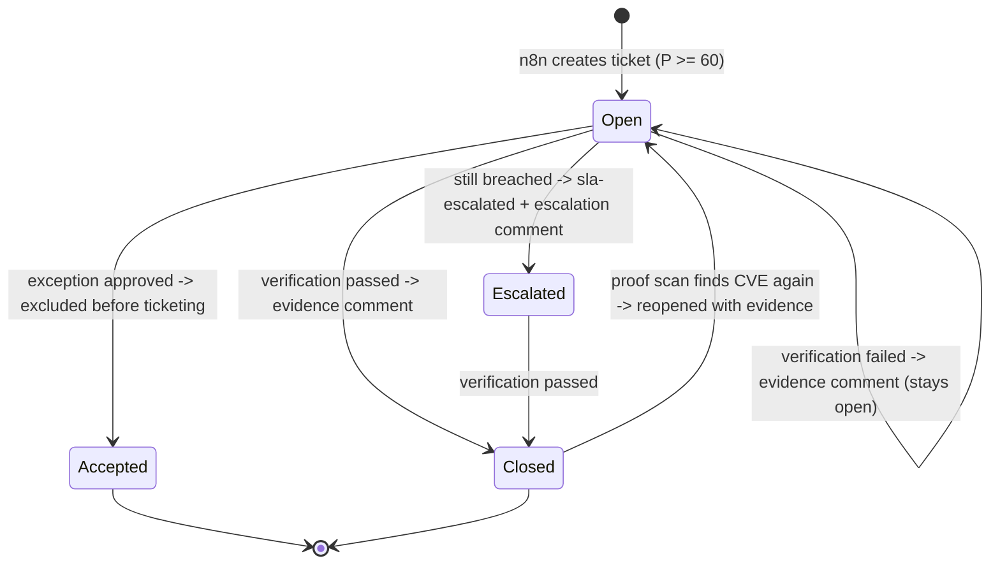
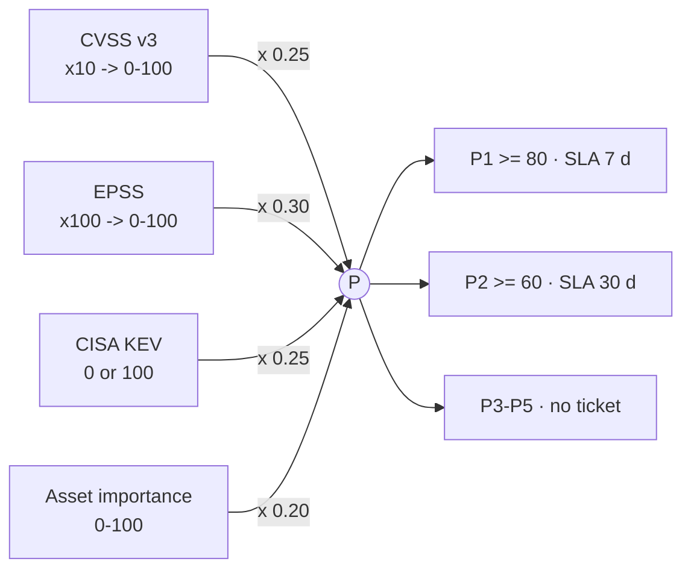

# Architecture

## 1. Components

n8n is the SOAR orchestrator and runs the project **from A to Z**:
scan -> aggregation/dedupe -> EPSS/KEV/asset enrichment -> priority -> ticket.
Laravel exposes a token-protected **agent API** (`X-Agent-Token` header) that n8n
calls to start/observe scans, fetch raw reports, inventory, KEV and exceptions,
and to publish the final ranked findings. Everything can still run locally
(`VULNMGMT_ORCHESTRATOR=local`) as a fallback.

### n8n workflows (imported from `n8n/workflows/`)

| Workflow | Triggers | What it does |
|---|---|---|
| **Vulnerability Pipeline (A to Z)** | cron `0 3 * * *` + webhook `POST /webhook/scan-request` | starts Trivy via agent API, polls, dedupes raw findings, fetches EPSS (batched), KEV, inventory and accepted risks, computes `P = 0.25C + 0.30E + 0.25K + 0.20A`, publishes `findings.json` back, opens Gitea tickets for P1/P2 with dedupe |
| **SLA Reminder and Escalation** | cron `0 9 * * *` + webhook `POST /webhook/sla-check` | P1 due in 48 h, P2 in 7 d: first breach -> comment + `sla-reminder` label, second pass -> escalation comment + `sla-escalated` label |
| **Remediation Verification** | webhook `POST /webhook/verify-request` `{ticket}` | proof scan (raw mode), compares fresh reports, **closes the ticket with evidence** if the CVE is gone, **reopens it with evidence** if it is still present |

## 2. End-to-end flow (scan -> ticket -> fix -> proof)

## 3. Ticket lifecycle

## 4. Priority model

